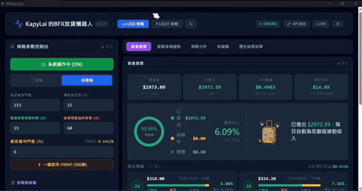

# BFX Lending Bot

> Bitfinex P2P 放貸自動化桌面應用 — 跨平台商業產品，透過 [Whop](https://whop.com) 平台授權銷售。




> 30 秒操作示範：資產總覽、借出明細、策略參數控制台與 USD / USDt 策略切換。

---

## 概覽

BFX Lending Bot 是一款針對 Bitfinex 放貸市場設計的自動化桌面工具，支援 fUSD、fUST、fBTC 多幣種並行操作。從市場深度分析、掛單執行到收益對帳全流程自動化，適合需要 24/7 不間斷運行的放貸用戶。

和市面上多數雲端代管型放貸服務最大的差別：**Bitfinex API Key 從頭到尾只留在使用者自己的電腦上**，以作業系統金鑰庫加密存放，不會上傳到任何伺服器。

此為 **私人原始碼的商業產品**，本 repo 僅作為作品集說明用途，不包含任何程式碼。

📐 **完整系統架構圖**：[BFX Lending Bot 架構（v4.2.0）](https://kapy0312.github.io/portfolio-next/architecture/bfx.html)

---

## 版本里程碑

| 版本 | 重點 |
|---|---|
| v3.x | 雙策略掛單引擎、收益對帳、雙層 Watchdog、多幣種並行、Windows / macOS 自動發版 |
| v4.0 | 對抗式安全稽核：19 項問題依 P1～P4 分級，P1 全數修復並完成實帳驗證 |
| v4.2 | 授權驗證移到伺服器端（AWS Lambda），安裝檔內不再持有任何 Whop 金鑰 |
| v4.3 | USD ↔ USDt 資金一鍵切換：依 VWAP 比較兩幣種利率，把閒置資金換到較佳的一邊 |

---

## 核心功能

### 智慧掛單引擎

- **二分法（Binary）** 與 **多階梯（Ladder）** 雙策略模式，依資金量自動切換
- **Smart Gap Detection**：分析 Orderbook 深度，鎖定斷層位置掛單，搶佔利率優勢
- **VWAP 追價**：成交量加權均價追蹤，冷啟動期自動延長觀察窗
- **Volatility Index**：波動率溢價層，行情劇烈時自動拉高掛單利率
- **EMA 持久化**：基準利率指數移動平均值寫入 SQLite，重啟後無縫恢復
- **利率保底機制**：多模型取最強底價，行情低迷時以底價排隊，避免賤賣

### 資金切換（v4.3）

- **一鍵切換 USD ↔ USDt**：比較兩幣種 VWAP，利率差超過門檻才允許切換
- **只動閒置資金**：只處理可用餘額與尚未成交的掛單，已借出的合約完全不碰
- **反向冷卻時間**：切換後一段時間內禁止反向切回，避免來回耗損手續費
- **權限檢查 fail-closed**：切換所需的 API 權限檢查失敗時，一律不啟動

### 自動化控制與容錯

- **四種撤單判斷**：TIMEOUT / LOW_APR / BOT（被機器人搶走）/ UNDERCUT（利率被壓低）
- **成交偵測**：DB 快照與即時清單比對，精確識別成交
- **雙層 Watchdog**：心跳監控（每 1 分鐘）+ 全量同步（每 5 分鐘）
- **熔斷機制**：API 回應 500 / 429 時暫停 30 秒，避免連續失敗惡化
- **null 合約**：查詢失敗一律回傳 `null`，呼叫端跳過本輪，絕不把「查不到」誤判成「餘額為 0」
- **子程序自動重啟**：策略引擎跑在獨立子程序，異常結束 3 秒後自動重啟，畫面不受影響

### 收益追蹤與對帳

- **Ledger 收益對帳**：按日顯示 Bitfinex 官方 Ledger 實收，與官方報表吻合
- **credit_lifecycle 追蹤**：自動記錄每筆放貸完整生命週期（開始、結束、提早解約判斷）
- **收益日曆與 7 天策略健檢**：歷史面板以日曆呈現每日收益，分析面板自動檢查近 7 天策略表現
- **realAPR 計算**：以 Ledger 實際收益反推年化報酬率，而非理論名目值

### 安全性與授權

- **OS 層級金鑰加密**：Electron `safeStorage` 綁定作業系統帳號，API Key 不以明文存放，只在策略子程序內解密
- **最小權限原則**：啟動時檢查 API Key，帶有提幣或交易權限一律拒絕執行
- **伺服器端授權驗證（v4.2）**：客戶端只送出序號與機碼，由 AWS Lambda 向 Whop 查詢；Whop 金鑰只存在雲端的加密參數中
- **離線容錯**：授權伺服器暫時無法連線時走 24 小時快取，只有「確定無效」才會擋下使用者
- **IPC 白名單**：`contextIsolation` 開啟，前端只能呼叫 preload 白名單內的通道，所有參數在主程序端驗證
- **日誌遮罩**：寫入日誌前遮罩金鑰類字串；打包前自動掃描，發現金鑰格式字串就中止建置

---

## 技術架構

```
┌──────────────────────── 使用者電腦（Windows / macOS）────────────────────────┐
│                                                                              │
│  ┌──────────── Renderer（React + Vite）────────────┐                         │
│  │ 儀表板 │ 收益日曆 │ 策略健檢 │ 設定 │ 授權閘門   │                         │
│  └───────────────────────┬─────────────────────────┘                         │
│                          │ preload.js（IPC 白名單）                          │
│  ┌───────────────────────▼─────────────────────────┐   ┌─────────────────┐  │
│  │ Main Process                                     │   │  SQLite (WAL)   │  │
│  │ main.js 生命週期・safeStorage・子程序管理        │◄─►│ 設定・掛單・    │  │
│  │ server.js IPC handlers（參數驗證）               │   │ 帳本・生命週期  │  │
│  │ license.service（24h 快取）                      │   └────────▲────────┘  │
│  └───────────────────────┬─────────────────────────┘            │           │
│                          │ fork（金鑰只放在子程序環境變數）     │           │
│  ┌───────────────────────▼─────────────────────────┐            │           │
│  │ bot-runner 子程序                                │────────────┘           │
│  │ Watchdog │ 定價策略 │ 掛撤單引擎 │ 熔斷 │ 同步   │                        │
│  └───────────┬──────────────────────────┬──────────┘                        │
└──────────────┼──────────────────────────┼───────────────────────────────────┘
               │ WebSocket / REST         │ HTTPS（序號 + 機碼）
        ┌──────▼──────┐          ┌────────▼─────────┐      ┌───────────┐
        │  Bitfinex   │          │ License Lambda   │─────►│  Whop API │
        └─────────────┘          │ （AWS，加密參數）│      └───────────┘
                                 └──────────────────┘
```

**設計重點**

- **主程序 / 子程序分離**：主程序只管視窗與 IPC，策略跑在 fork 出來的子程序；策略當掉不會拖垮畫面，金鑰也只存在子程序裡
- **WebSocket 決定何時觸發、REST 負責執行**：WS 推送錢包變動後防抖 3 秒觸發策略，下單與查詢走 REST，Watchdog 定期全量同步補漏

### 資料庫 Schema（概念層）

| 資料表 | 用途 |
|---|---|
| `configs` | 各幣種策略參數、加密後的金鑰、EMA 基準 |
| `offers` | 掛單記錄（以 Bitfinex 回傳的真實 Offer ID 寫入） |
| `credit_lifecycle` | 放貸生命週期追蹤（開 / 關時間、提早解約） |
| `stats` / `ledgers` | 資產快照、每日利息帳本 |
| `logs` | 運行日誌（定期自動清理） |
| `eula_agreements` | 使用者同意條款記錄 |

---

## 多幣種並行

單一子程序同時管理最多 3 個幣種的獨立策略，每個幣種的啟停狀態分開記錄：

| 幣種 | 說明 |
|---|---|
| `fUSD` | 美元放貸（主力） |
| `fUST` | Tether (USDt) 放貸 |
| `fBTC` | 比特幣放貸 |

---

## 測試與品質

| 範圍 | 工具 | 測試數 |
|---|---|---|
| 主程序與策略引擎 | Jest | 217 |
| React 前端 | Vitest | 38 |
| 授權伺服器（Lambda） | Jest | 29 |

- 測試絕不連線真實的 Bitfinex 或 Whop，一律使用 mock
- v4.0 安全稽核的 P1 修復，除單元測試外另以實際帳戶逐項手動驗證

---

## CI/CD 流程

```
git tag v4.x.x → push → GitHub Actions 觸發

1. 品質檢查（Ubuntu）
   └─ npm audit + ESLint

2. Build Windows（Windows runner）
   └─ electron-builder NSIS → .exe 安裝包

3. Build macOS（arm64 / x64）
   └─ electron-builder DMG

4. Release
   └─ 依 CHANGELOG 產生 Release Notes
   └─ 上傳三平台安裝包，更新 versions.json 供 App 內檢查更新
```

另有獨立的測試 workflow，每次 push 自動執行全部測試。只有推送 `v*` tag 才會發版，本機打包僅供測試，不會對外發布。

---

## 技術選型

| 層 | 技術 | 理由 |
|---|---|---|
| 桌面框架 | Electron v40 | 跨平台 + Node.js 生態，全端統一 JavaScript |
| 前端 | React 18 + Vite + Tailwind CSS | 快速開發，i18n 中英文、深淺色模式 |
| 資料庫 | better-sqlite3 (WAL) | 同步 API、高效能，WAL 允許同時讀寫 |
| 金鑰加密 | Electron safeStorage | OS 層級金鑰庫，金鑰不落地 |
| 授權伺服器 | AWS Lambda（SAM 部署） | 金鑰集中於雲端加密參數，按次計費、免維運 |
| 授權平台 | Whop | 現成的商業授權與金流基礎設施 |
| 日誌 | Winston + daily-rotate | 結構化 log，自動輪換 |
| 測試 | Jest / Vitest | 主程序、前端、Lambda 分開測試 |
| CI/CD | GitHub Actions | 多平台矩陣建置，tag 觸發自動發版 |

---

## 商業資訊

- 透過 [Whop](https://whop.com) 平台銷售，已有付費用戶
- 支援 Windows 10/11（x64）和 macOS（arm64 / x64）
- 原始碼為私人 repository，不對外開放

---

*Built by [Kevin Lai](https://github.com/kapy0312) · [作品集網站](https://kapy0312.github.io/portfolio-next/)*
